# 修复记录：从 66 个编译错误到可正常运行

> 本文记录这次"让程序跑起来"的全部改动：**删了什么、加了什么、为什么改、原代码留在哪**。
> 建造顺序请看同目录的《从零重建项目的创建顺序.md》，本文只讲这次修复。
> 参考实现：<https://github.com/YYsuni/2025-blog-public>

---

## 1. 结论

| 项目 | 修复前 | 修复后 |
| --- | --- | --- |
| `pnpm build` | 失败（66 个 `Module not found`，18 个文件） | ✅ 成功，12 个页面路由（构建输出 13 条，含 `_not-found`） |
| `pnpm exec tsc --noEmit` | 无法完成（模块都解析不了） | ✅ 0 error |
| `pnpm dev` | 打不开 | ✅ 正常，`http://localhost:2025` |
| 浏览器控制台 | — | ✅ 0 个页面异常 / 0 个 JS 报错（只剩沙箱内被拦的外部字体、外链图片、音频请求被浏览器取消） |
| 可访问路由 | `/` `/about` `/blog` `/bloggers` `/projects` `/share` | 上面 6 个 + `/blog/[id]` `/clock` `/write` `/write/[slug]` `/pictures` `/live2d` |

**没有删除任何业务代码**：改动方式只有"新增文件""新增代码""把旧代码注释掉"三种。被注释的原始代码见第 6 节，逐处列了文件与行号。

启动方式：

```powershell
cd F:\小工具\Blog-Yihe-Rebuild
pnpm dev        # 开发，http://localhost:2025
pnpm build      # 生产构建
pnpm start      # 跑生产版本
```


---

## 2. 问题清单（按出现顺序）

修复时错误是"挤牙膏"式出现的：先全部是模块找不到，补完模块才暴露 JSON、类型问题，构建通过后才暴露运行期问题。下面这张表就是实际踩坑顺序。

| # | 现象 | 根因 | 处理方式 |
| --- | --- | --- | --- |
| 1 | `Module not found: Can't resolve ...` × 66，涉及 18 个文件、60+ 个模块 | 项目是从参考仓库**拷了一部分文件**来的，被 import 的模块（hooks / lib / components / services / svgs）根本没拷过来 | 从参考仓库按 import 闭包逐个补齐，见第 4 节 |
| 2 | `Failed to transpile "next.config.ts"` | 项目里装的 TypeScript 是 **7.0.2**，Next 16.0.10 的配置转译器不认 | 配置改成纯 ESM 的 `next.config.mjs`，不用 TS 转译 |
| 3 | SVG 当组件用（`import GithubSVG from '@/svgs/github.svg'`）却没有 SVGR | 项目**根本没有 next.config**，也没装 `@svgr/webpack` | 新建 `next.config.mjs`，配置 Turbopack + webpack 两套 SVG loader |
| 4 | `Export getFilenameExtension doesn't exist` / `formatBytes` 不存在 | 本地 `src/lib/utils.ts` 比参考仓库少两个导出函数 | 补函数（纯新增，不改旧函数） |
| 5 | `src/config/card-styles-default.json` 是 **0 字节** | 空文件不是合法 JSON，Turbopack 直接报 `EOF while parsing a value` | 用参考仓库的默认卡片布局填回去 |
| 6 | `It looks like you're trying to use TypeScript but do not have the required package(s) installed` + `The "id" argument must be of type string` | 同第 2 条：TS 7 不被 Next 16 识别，Next 以为没装 TS，又去 `pnpm add typescript`，然后崩掉 | `typescript` 降到 `^5.9.3`（参考仓库用的也是 `^5`） |
| 7 | `color-config.tsx` 里 7 个 `Property 'colorBrandSecondary' does not exist on type '{}'` | `tsconfig.json` 是 `"strict": false`，关掉 `strictNullChecks` 后 `formData.theme ?? {}` 被推断成 `Theme \| {}` 联合类型，属性访问全报错 | 打开 `"strict": true`（参考仓库就是 true），代码一行没改 |
| 8 | `home-layout.tsx` 的 `TS2352`：`card-styles-default.json` 转不成 `CardStyles` | 默认布局里 `offsetX/offsetY` 是 `null`，而 `card-styles.json` 里是数字，两个 JSON 的字面量类型不重叠 | 改成 `as unknown as CardStyles`，原来那行保留为注释 |
| 9 | `/blog` 控制台刷屏 `Maximum update depth exceeded`（**真 bug，不是环境问题**） | `useBlogIndex()` 每次渲染都 `filter()` 出新数组，`blog/page.tsx` 里 `useEffect(..., [items])` 紧跟着 `setEditableItems(items)` → 死循环 | 用 `useMemo` 缓存过滤结果，同时修掉 `useLatestBlog` 的原地 `sort()` |
| 10 | 每个页面都请求 `https://blog-liker.yysuni1001.workers.dev/api/like` 并失败 | 参考仓库把**作者自己的** Cloudflare Worker 地址写死在 `components/like-button.tsx` | 改成读 `NEXT_PUBLIC_LIKE_API`，默认空 = 不发请求，只保留本地动画 |
| 11 | `blog/[id]` 里 `origin is not defined`（参考仓库自带的 bug） | 渲染封面时用了从未声明的 `origin`，文章只要有 `cover` 就抛 `ReferenceError` | 补上 `origin` 定义（浏览器端取 `window.location.origin`） |
| 12 | 头像、图片、音乐、favicon 全部 404 | 项目**没有 `public/` 目录** | 从参考仓库补 `images` / `music` / `favicon.png` / `manifest.json`，另建示例文章 |
| 13 | 整站没有导航、没有背景、没有主题色，卡片糊成一团 | `src/app/layout.tsx` 还是"阶段一的最小版本"，只渲染 `<body>{children}</body>`；`src/styles/globals.css` 也是残桩，`.card` 等工具类全缺 | 根布局套上 `@/layout`，globals.css 补回完整工具类 |
| 14 | `node_modules`、`.next`、`*.pem` 会被提交进 git | 项目没有 `.gitignore` | 新增 `.gitignore`（含 `.env*`、`*.pem`） |

---

## 3. 验证记录（可复现）

```powershell
# 1) 类型检查
pnpm exec tsc --noEmit          # 0 error

# 2) 干净构建（先删 .next，排除缓存掩盖问题）
Remove-Item -Recurse -Force .next
pnpm build                      # ✓ Compiled successfully，13 条输出（含 _not-found）

# 3) 开发服务器
pnpm dev                        # Ready in ~1s

# 4) 路由探活
$routes = '/','/blog','/blog/hello-world','/about','/projects','/share','/bloggers','/clock','/write','/pictures','/live2d'
foreach ($r in $routes) { (Invoke-WebRequest "http://localhost:2025$r" -UseBasicParsing).StatusCode }
# 全部 200
```

另外用无头 Chrome（playwright-core + 本机 Chrome）逐页跑了一遍，收集 `pageerror`、`console.error`、失败请求，
并模拟了这些交互：`Ctrl+L` 打开站点设置、切到"首页布局"、切到"色彩配置"、博客页切"分类"分组、进/退编辑模式、
首页"进入主页拖拽布局"、点赞按钮点击、390×844 移动端。

结果：**没有任何页面异常、没有任何 JS 报错**。所有页面关闭后仅剩下以下几类"环境性"失败请求，与代码无关：

- `fonts.googleapis.cn` / `fonts.gstatic.cn`：本次验证环境不能访问 Google 字体（脚本里主动 abort 了）；
- `projects/list.json`、`share/list.json`、`bloggers/list.json` 里少量**外链图片**（原作者站点、第三方头像），沙箱 DNS/ORB 拦截；
- `/music/close-to-you.mp3` 的 `ERR_ABORTED`：浏览器主动取消媒体请求，属正常现象；
- 页面跳转时的 `?_rsc=` 预取被取消，属正常现象。

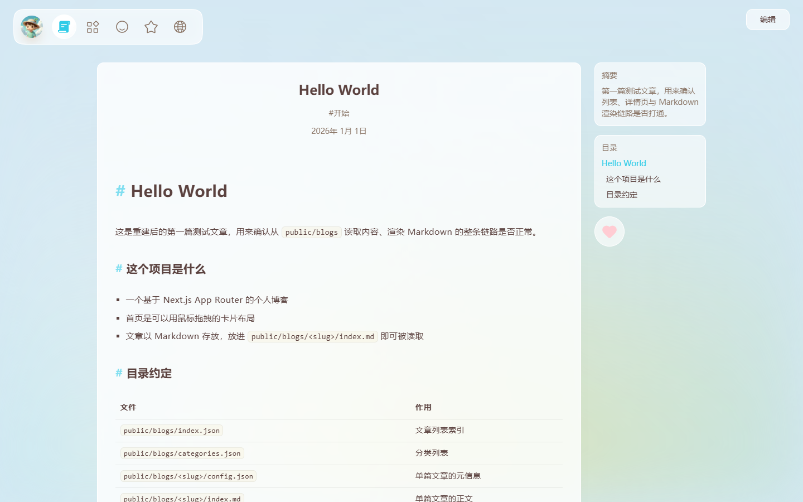

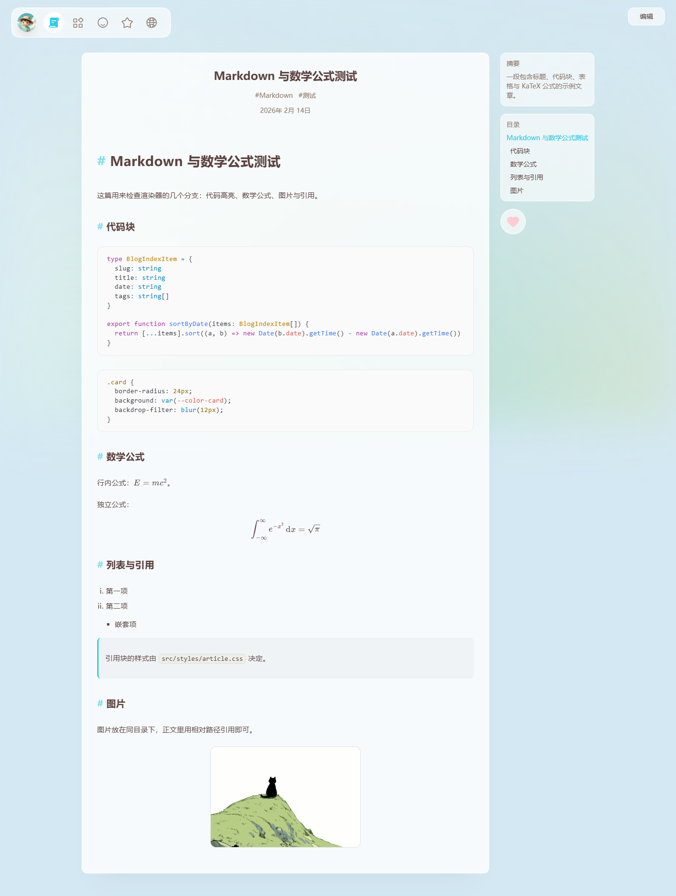

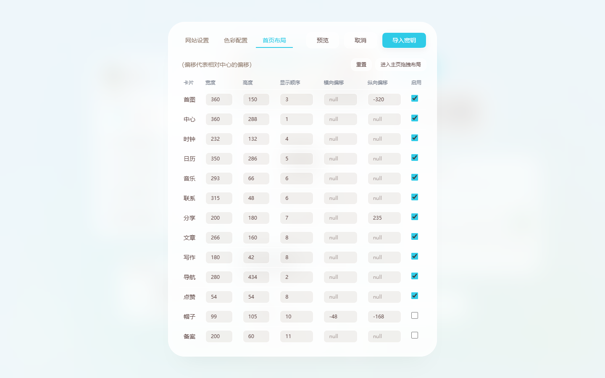

---

## 4. 新增了什么（共 107 个 src 文件 + 93 个静态资源 + 3 个根配置）

> "来源"一栏：
> **参考仓库** = 原样从 <https://github.com/YYsuni/2025-blog-public> 的 `src/` 复制（仅做必要的 UTF-8/行尾处理，内容一致）；
> **新建** = 这次为让项目跑起来自己写的。

### 4.1 图标 `src/svgs/`（31 个，全部来自参考仓库）

`about-filled` `about-outline` `dots` `dragger` `email` `facebook` `github` `instagram` `juejin` `music` `pen` `play`
`projects-filled` `projects-outline` `qq` `scroll-filled` `scroll-outline` `share-filled` `share-outline` `short-line`
`tg` `tiktok` `top` `website-filled` `website-outline` `wechat` `weibo` `x` `哔哩哔哩` `小红书` `知乎`（均为 `.svg`）

> 缺这些是第一批报错的主因：`social-buttons.tsx` 一个文件就 import 了 12 个 svg。

### 4.2 Hook `src/hooks/`（5 个，参考仓库）

| 文件 | 谁在用 |
| --- | --- |
| `use-auth.ts` | 首页配置弹窗、`/about`、`/blog`、`/projects`、`/share`、`/bloggers` |
| `use-blog-index.ts` | 首页"最新文章"卡片、`/blog`（**本次修过死循环，见第 5 节**） |
| `use-categories.ts` | `/blog` 的分类分组 |
| `use-markdown-render.tsx` | `/about`、文章详情 |
| `use-read-articles.ts` | `/blog` 已读标记、文章详情 `markAsRead` |

### 4.3 底层库 `src/lib/`（9 个，参考仓库）

`aes256-util.ts` `auth.ts` `blog-index.ts` `color.ts` `file-utils.ts` `github-client.ts` `github-commit.ts`
`load-blog.ts` `markdown-renderer.ts`

覆盖三条链路：GitHub App 认证（JWT → Installation Token）、提交（blob/tree/commit/ref）、Markdown 渲染（marked + shiki + katex）。

### 4.4 通用组件 `src/components/`（18 个文件，下表把同类合并展示）

| 文件 | 来源 | 用途 |
| --- | --- | --- |
| `blog-preview.tsx` | 参考仓库 | 文章正文排版（目录、代码块、附件、点赞） |
| `blog-sidebar.tsx` | 参考仓库 | 文章页右侧摘要栏 |
| `blog-toc.tsx` | 参考仓库 | 文章目录 |
| `code-block.tsx` | 参考仓库 | 代码块 + 复制按钮 |
| `color-picker.tsx` | 参考仓库 | 主题色选择 |
| `color-picker-panel.tsx` | 参考仓库 | 取色面板 |
| `editable-star-rating.tsx` | 参考仓库 | 可编辑星级（分享/友链） |
| `like-button.tsx` | 参考仓库 | 点赞（**本次改过接口地址，见第 5 节**） |
| `markdown-image.tsx` | 参考仓库 | 正文图片懒加载 |
| `media-upload-dialog.tsx` | 参考仓库 | 图片上传弹窗 |
| `music-card.tsx` | 参考仓库 | 首页音乐卡片 |
| `select.tsx` | 参考仓库 | 下拉选择 |
| `star-rating.tsx` | 参考仓库 | 只读星级 |
| `wip.tsx` | 参考仓库 | "开发中"占位卡片（4.8 里的 4 个占位页都在用） |
| `liquid-grass/index.tsx` + `border.png` `displacement-1.png` `displacement-2.png` | 参考仓库 | 文章正文里的液体草地特效 |

### 4.5 外壳 `src/layout/`（3 个）

| 文件 | 来源 | 说明 |
| --- | --- | --- |
| `backgrounds/snowfall.tsx` | 参考仓库 | 圣诞雪花背景（首页在用） |
| `backgrounds/utils.ts` | 参考仓库 | `blurred-bubbles.tsx` 缺失的工具函数 |
| `head.tsx` | 参考仓库**改写** | 只保留 viewport / manifest / favicon / 标题字体；**删掉了原作者的 Google Analytics 片段**（第三方统计 ID，不该带进你的仓库） |

### 4.6 页面与业务 `src/app/`（41 个）

| 目录 | 文件 | 来源 |
| --- | --- | --- |
| `(home)/` | `home-draggable-layer.tsx`（卡片拖拽层） | 参考仓库 |
| `(home)/config-dialog/` | `color-config.tsx`、`home-layout.tsx`、`site-settings/` 下 9 个文件 | 参考仓库 |
| `(home)/services/` | `push-site-content.ts` | 参考仓库 |
| `blog/` | `types.ts`、`components/blog-cover-hover.tsx`、`components/category-modal.tsx`、`services/save-blog-edits.ts`、`[id]/page.tsx` | 参考仓库（`[id]` 修过 `origin`） |
| `about/` | `services/push-about.ts` | 参考仓库 |
| `projects/` | `components/{project-card,create-dialog,image-upload-dialog}.tsx`、`services/push-projects.ts`、`list.json` | 参考仓库 |
| `share/` | `components/{share-card,create-dialog,logo-upload-dialog}.tsx`、`grid-view.tsx`、`services/push-shares.ts`、`list.json` | 参考仓库 |
| `bloggers/` | `components/{blogger-card,create-dialog,avatar-upload-dialog}.tsx`、`grid-view.tsx`、`services/push-bloggers.ts`、`list.json` | 参考仓库 |
| `clock/` | `page.tsx`（独立时钟页，首页时钟点进去的落地页） | 参考仓库 |
| `write/` | `page.tsx`、`write/[slug]/page.tsx` | **新建**（占位页，见 4.8） |
| `pictures/` | `page.tsx` | **新建**（占位页） |
| `live2d/` | `page.tsx` | **新建**（占位页） |

### 4.7 静态资源 `public/`（93 个文件）

| 路径 | 数量 | 来源 | 说明 |
| --- | --- | --- | --- |
| `public/images/**` | 89 | 参考仓库 | 头像、首图（art）、帽子、雪花、分享 logo、友链头像、项目图、图片墙 |
| `public/music/**` | 2 | 参考仓库 | 音乐卡片的 `close-to-you.mp3` 与 `christmas.m4a` |
| `public/favicon.png`、`public/manifest.json` | 2 | 参考仓库 | `head.tsx` 引用的站点图标与 PWA 清单 |
| `public/blogs/**` | 8 | **新建** | 示例内容，见下 |

`public/blogs` 是新建的最小内容骨架（原项目完全没有）：

```
public/blogs/index.json          # 3 条索引：hello-world / markdown-demo / hidden-draft(hidden)
public/blogs/categories.json     # ["随笔","技术"]
public/blogs/hello-world/         index.md + config.json
public/blogs/markdown-demo/       index.md + config.json   # 覆盖代码块、表格、KaTeX 公式、图片
public/blogs/hidden-draft/        index.md + config.json   # hidden:true，验证"未导入密钥看不到"
```

### 4.8 占位页（4 个，**新建**）

首页和文章页有很多跳转，但对应功能还没重建到那一阶段。直接留空会让点击变成 404，
所以先放"开发中"占位页兜底，复用参考仓库的 `components/wip.tsx`：

| 文件 | 谁在跳 |
| --- | --- |
| `src/app/write/page.tsx` | 首页"写文章"按钮 |
| `src/app/write/[slug]/page.tsx` | 文章详情页右上角"编辑"按钮 |
| `src/app/pictures/page.tsx` | 首页首图卡片点击 |
| `src/app/live2d/page.tsx` | 首页头像点击 |

> 这 4 个页面**不是最终实现**，只是防止 404。按《从零重建项目的创建顺序.md》阶段五/七/八补齐后直接替换即可。

### 4.9 根配置（3 个）

| 文件 | 来源 | 为什么需要 |
| --- | --- | --- |
| `next.config.mjs` | 参考仓库 `next.config.ts` **改写** | ① SVG 当组件导入必须配 `@svgr/webpack`（Turbopack 与 webpack 两套规则）；② 用 `.mjs` 绕开 TS7 转译报错；③ 加 `devIndicators: false` 与 `allowedDevOrigins`（否则用 127.0.0.1 打开时会警告跨域）；④ 加 `images.remotePatterns` 放行 jsDelivr（否则 `next/image` 用远程图会白屏，见第 9 节） |
| `global.d.ts` | 参考仓库 | 给 `*.svg`、`*.svg?url` 声明模块类型，否则 TS 认不出 `import X from '*.svg'` |
| `.gitignore` | 参考仓库 + 增加 `.idea/` | 防止 `node_modules`、`.next`、`*.pem`、`.env*` 进仓库 |

---

## 5. 修改了什么（10 个原有文件 + 2 个"搬进来又修过"的文件）

> 每处改动都在代码里留了 `[新增] / [修改] / [修正] / [补齐]` 注释，搜这几个词就能定位。
> 5.11 与 5.12 两节的文件本身是本次新搬进来的（见第 4 节），但搬进来后又修了内容，所以一并记在这里。

### 5.1 `package.json` — 依赖变动

| 类型 | 包 | 变化 | 原因 |
| --- | --- | --- | --- |
| 降级 | `typescript` | `^7.0.2` → `^5.9.3` | Next 16.0.10 只认 TS 5；TS 7 会让 `next build` 的类型检查阶段直接崩（表格 #6） |
| 新增（dev） | `@svgr/webpack@^8.1.0` | — | SVG 转 React 组件的 loader |
| 新增（dev） | `@types/jsrsasign@^10.5.15` | — | `jsrsasign` 自己没有类型声明，`lib/auth.ts`、`lib/github-client.ts` 会报 TS7016 |
| 新增 | `tailwindcss-animate@^1.0.7` | — | `globals.css` 里的 `@plugin 'tailwindcss-animate'` 需要它 |

### 5.2 `tsconfig.json` — 3 处

| 行 | 改动 | 原因 |
| --- | --- | --- |
| 17 | `"strict": false` → `"strict": true` | 不打开时 `formData.theme ?? {}` 被推断成联合类型，`color-config.tsx` 报 7 个 TS2339（表格 #7） |
| 22 | `"moduleResolution": "node"` → `"bundler"` | `motion/react`、`sonner` 等包只提供 `exports` 字段，node10 解析找不到（与参考仓库一致） |
| 33 | `include` 增加 `"global.d.ts"` | 让 SVG 模块声明生效 |

### 5.3 `src/app/layout.tsx` — 恢复全站外壳

- **新增**（第 5、7 行）：`import Layout from '@/layout'`、`import Head from '@/layout/head'`
- **新增**（第 19–27 行）：`metadata` 里补 `openGraph` / `twitter`
- **新增**（第 30–41 行）：把 `site-content.json` 的 8 个主题色注入成 `--color-*` CSS 变量，挂到 `<html style>` 上
- **新增**（第 46 行）：`<Head />`
- **新增**（第 49–58 行）：Windows UA 打 `windows` class（配合 `globals.css` 隐藏滚动条）
- **修改**（第 62 行）：`{children}` → `<Layout>{children}</Layout>`，导航卡片、气泡背景、Toast、音乐卡片、回到顶部按钮由 Layout 提供
- **保留**（第 64–71 行）：原来的 `return (...)` 整段作为注释留在原位

> 这是"整站看起来能用"和"整站像白纸"的分水岭。原文件是阶段一的最小版本，`src/layout/index.tsx` 写好了却没人调用。

### 5.4 `src/styles/globals.css` — 从残桩恢复为完整样式入口

原文件只有 15 行（`@import 'tailwindcss'` + 3 个变量 + `html/body`），缺少所有页面都依赖的 `.card`、`.brand-btn`、`text-linear`、`bg-linear` 等工具类。

- **新增**：`@import 'katex/dist/katex.min.css'`（公式样式）
- **新增**：`@import './theme.css'`、`@import './article.css'`（这两个文件本来就存在，但从没被引用过）
- **新增**：`@plugin 'tailwindcss-animate'`
- **新增**：`scrollbar-none` 工具类、`@layer base` 基础样式、`.range-track` 音量条、`.windows` 滚动条
- **新增**：`card` / `card-rounded` / `text-linear` / `bg-linear` / `shadow` / `btn-rounded` / `brand-btn` / `no-spinner`
- **新增**：`heartbeat-frame` 点赞动画、Tiptap 编辑器样式（写作器迁移后直接可用）
- **保留**：原 15 行内容**整段注释**在文件末尾（第 222–239 行），一个字都没删

### 5.5 `src/lib/utils.ts` — 补 2 个函数（未改旧函数）

| 行 | 新增 | 谁在用 |
| --- | --- | --- |
| 24–28 | `getFilenameExtension(filename, fallback)` | `lib/github-commit.ts` 算文件扩展名 |
| 40–46 | `formatBytes(bytes)` | `components/blog-preview.tsx` 显示附件大小 |

### 5.6 `src/config/card-styles-default.json` — 空文件 → 默认布局

原文件 0 字节，Turbopack 直接报 `invalid JSON: EOF while parsing a value`。

现在填入的是参考仓库里的出厂默认值（各卡片的宽高、偏移、是否启用）。
它的用处有两个：站点设置 → "首页布局" 里的**"重置"按钮**读它，`home-layout.tsx` 也 import 它。
和 `card-styles.json` 的区别：**`card-styles-default.json` 是出厂默认值，`card-styles.json` 是当前生效值**。

### 5.7 `src/consts.ts` — 新增点赞接口配置

**新增**（第 7–14 行）：

```ts
export const LIKE_API = process.env.NEXT_PUBLIC_LIKE_API || ''
```

原因见 5.9。想启用远程点赞就在 `.env.local` 里写 `NEXT_PUBLIC_LIKE_API=https://你的服务/api/like`，
不写则完全不发请求。

### 5.8 `src/hooks/use-blog-index.ts` — 修 `/blog` 无限循环（真 bug）

- **修正 1**（第 27–39 行）：`let result = data || []; result = result.filter(...)` 每次渲染都是**新数组**，
  调用方 `useEffect(..., [items])` 每轮都触发 `setState` → `Maximum update depth exceeded`。
  改为 `useMemo(() => ..., [data, isAuth])` 保持引用稳定。原写法作为注释保留（第 31–35 行）。
- **修正 2**（第 51 行）：`items.sort()` 会**就地**打乱 SWR 缓存里的数组，改为 `[...items].sort()`。

### 5.9 `src/components/like-button.tsx` — 去掉原作者的服务地址

- **修正 1**（第 16–20 行）：删除写死的 `const ENDPOINT = 'https://blog-liker.yysuni1001.workers.dev/api/like'`，
  改为 `const ENDPOINT = LIKE_API`；原值作为注释保留在第 17 行。
- **修正 2**（第 49 行）：没配置接口时把 SWR 的 key 传 `null`，SWR 不发请求。
- **修正 3**（第 72–76 行）：点击点赞时若没配置接口，直接本地 `mutate` 计数，不发 `POST`。

> 这个地址是参考仓库作者自己的 Cloudflare Worker。别人的仓库部署起来必然请求失败，
> 每个页面（首页、`/about`、文章页都有点赞按钮）控制台都会多一条跨域/超时错误。

### 5.10 `src/components/nav-card.tsx` — 首屏头像加 `priority`

**修正**（第 143–152 行）：`<Image src='/images/avatar.png' ... priority />`。
Next 会对首屏 LCP 图片提示 `Please add the loading="eager" property`，加 `priority` 消除该警告。

### 5.11 `src/app/blog/[id]/page.tsx` — 补未声明的 `origin`

**修正**（第 51–53 行）：参考仓库原文件第 79 行是 `cover={blog.cover ? ... : \`${origin}${blog.cover}\`}`，
其中 `origin` **从未声明**，文章一旦配置了 `cover` 就抛 `ReferenceError: origin is not defined`（参考仓库自带的 bug）。
补 `const origin = typeof window === 'undefined' ? '' : window.location.origin`（第 51–53 行），
第 83 行用到 `origin` 的封面逻辑保持原样、不再改动。

### 5.12 `src/app/(home)/config-dialog/home-layout.tsx` — 类型断言修正

**修正**（第 42–45 行）：`setCardStylesData(cardStylesDefault as CardStyles)` 报 TS2352，
改为 `as unknown as CardStyles`；原行作为注释保留在第 44 行。原因见表格 #8。

---

## 6. 只注释、没有删除的代码（逐处）

按你的要求，出错/失效的旧代码全部以注释形式留在原地，共 5 处：

| # | 文件 | 位置 | 被注释的内容 |
| --- | --- | --- | --- |
| 1 | `src/app/layout.tsx` | 第 64–71 行 | 原来的 `return (<html lang='zh-CN'><body>{children}</body></html>)` |
| 2 | `src/styles/globals.css` | 第 222–239 行 | 原来的 15 行残桩样式（`@import 'tailwindcss'` + `:root` + `html, body`） |
| 3 | `src/hooks/use-blog-index.ts` | 第 31–35 行 | 原来的 `let result = data \|\| []` 与 `if (!isAuth) result = result.filter(...)` |
| 4 | `src/components/like-button.tsx` | 第 17 行 | 原来的 `const ENDPOINT = 'https://blog-liker.yysuni1001.workers.dev/api/like'` |
| 5 | `src/app/(home)/config-dialog/home-layout.tsx` | 第 44 行 | 原来的 `setCardStylesData(cardStylesDefault as CardStyles)` |

除此之外**没有任何文件被删除**，`src/` 下原有 44 个文件全部还在（`_before-fix/` 备份可与当前目录对比确认）。

---

## 7. 从参考仓库搬代码时，特意"没搬"的东西

参考仓库是别人部署在自己域名上的站点，有几处和"你的仓库"强绑定，搬过来只会带来报错或隐私问题：

| 没搬 | 位置 | 原因 |
| --- | --- | --- |
| Google Analytics | 参考仓库 `layout/head.tsx` | 绑定原作者统计 ID `G-ZNSFR7C9PM`，属第三方跟踪 |
| 点赞 Worker 地址 | 参考仓库 `components/like-button.tsx` | 原作者私有服务，见 5.9 |
| `typescript.ignoreBuildErrors: true` | 参考仓库 `next.config.ts` | 它把**所有类型错误吃掉**。这里选择真正修好类型，而不是关掉检查 |
| `reactCompiler: true` | 同上 | 需要额外装 `babel-plugin-react-compiler`，当前用不到 |
| `codeInspectorPlugin` | 同上（原本就是注释状态） | 开发辅助插件，依赖额外包 |
| `/zh` `/en` 重定向 | 同上 | 参考站点做过多语言，本项目没有 |
| `opennext` / `wrangler` / Cloudflare 部署配置、`@tiptap/*`（写作器）、`pixi`（Live2D） | 参考仓库根目录、`app/write`、`app/live2d` | 属于阶段五/八，等对应页面真正迁移时再装 |

---

## 8. 仍然存在的边界（不是错误，但要清楚）

1. ~~**`/write`、`/write/[slug]` 是占位页**~~ —— **已在第 14 节补成真实的写作器**（Tiptap 编辑器 + 发布到 GitHub）；
   `/pictures`、`/live2d` 仍然是占位页，属于《创建顺序》阶段七/八。
2. **保存功能需要私钥**：界面上的"导入密钥"要选 `*.pem`。没导入时只能阅读，不会报错。
   相关环境变量见 `src/consts.ts` 的 `GITHUB_CONFIG`（`NEXT_PUBLIC_GITHUB_OWNER/REPO/BRANCH/APP_ID/ENCRYPT_KEY`）。
3. **没有迁移的页面**：`/snippets`、`/music`、`/svgs`、`/image-toolbox`、`/wuthering-waves`、`rss.xml`、`sitemap.ts`。
   当前导航与首页卡片都不指向它们，所以不会 404。
4. **示例内容是我新写的**：`public/blogs` 下 3 篇文章、`projects/share/bloggers/list.json` 是参考仓库的示例数据
   （其中少量外链图片指向原作者站点或第三方，离线时控制台会有"加载失败"，联网即正常）。换成你自己的内容即可。
5. **字体走外网**：`head.tsx` 引用了 `fonts.googleapis.cn` 的 `Averia Gruesa Libre`，取不到时会退回系统字体，不影响功能。
6. **首页头像**是 `hi-card.tsx` 里的远程 jsdelivr 地址（普通 ``，不需要额外配置）；
   导航头像原来用本地 `/images/avatar.png`，后来改成了远程地址，见第 9 节。

---

## 9. 追加修复：把导航头像换成远程地址后整页白屏

**发生时间**：2026-11-15 19:30 左右（`src/components/nav-card.tsx` 被改动之后）

### 现象

开发服务器能起来、`pnpm build` 也能过，但浏览器打开任何页面都是：

```
Application error: a client-side exception has occurred while loading localhost
```

控制台真正的报错是：

```
Error: Invalid src prop (https://fastly.jsdelivr.net/gh/iusine/Image-bed/avatar.png) on `next/image`,
hostname "fastly.jsdelivr.net" is not configured under images in your `next.config.js`
```

### 根因

`nav-card.tsx` 里原本是：

```tsx
<Image src='/images/avatar.png' ... />        // 本地图片，随便用
```

改成了远程地址：

```tsx
<Image src='https://fastly.jsdelivr.net/gh/iusine/Image-bed/avatar.png' ... />
```

`next/image` 和普通 `` 不一样：**远程图片的域名必须先在 `next.config.mjs` 的 `images.remotePatterns` 里登记**，
否则渲染时直接 `throw`，React 没有错误边界接住 → 整个页面白屏。

注意这个检查只在**运行时**做，所以 `pnpm build` / `tsc` 都不会报错，很容易误判成"代码没问题"。

### 修复

`next.config.mjs` 新增（第 8–17 行）——只加配置，**你改的 nav-card.tsx 一行没动**：

```js
images: {
    remotePatterns: [
        { protocol: 'https', hostname: 'fastly.jsdelivr.net', pathname: '/**' }
    ]
},
```

### 验证

- `http://localhost:2025/` 正常渲染，标题 `Yihe`，头像通过 `/_next/image?url=https%3A%2F%2Ffastly.jsdelivr.net...` 加载成功（48×48）；
- `/`、`/blog`、`/blog/hello-world`、`/about`、`/projects`、`/share`、`/bloggers`、`/clock` 逐页检查：**0 个页面异常、0 个 JS 报错**。

### 以后换图床怎么改

1. 图片在某个 CDN/图床上 → 把该域名加进 `remotePatterns`；
2. 图床域名会变、或只是偶尔一张图 → 给那个 `<Image>` 加 `unoptimized`，绕过优化器就不校验域名；
3. 本地 `public/` 下自己的图 → 直接用 `/xxx.png`，不用配置。

---

## 10. 如果改坏了，怎么回滚

- 本次改动前的完整快照在仓库外：`F:\小工具\_before-fix\`（`src/` + `package.json` + `tsconfig.json` + `postcss.config.mjs`）。
- 参考仓库克隆在：`F:\小工具\_ref-2025-blog-public\`（`git log` 可查具体版本）。
- 仓库当前还没有任何 commit（`git log` 报 `does not have any commits yet`），所以 `git status` 里能直接看到所有新增文件；
  建议先提交一次"修复前"状态再对比，或直接提交现在这版作为基线：

```powershell
cd F:\小工具\Blog-Yihe-Rebuild
git add -A
git commit -m "fix: 补齐缺失模块与配置，修复 /blog 无限渲染与写死的点赞接口"
```

---

## 11. 功能追加：日历卡片显示农历

**需求**：在公历日期后面显示农历（`2026/11/15 周日 · 十月初七`），并且每个日期格子里的数字下面显示当天农历（15 号下面显示「初七」），跟随系统日期自动变化。

### 11.1 新增文件

| 文件 | 内容 |
| --- | --- |
| `src/lib/lunar.ts` | 农历换算，导出 `getLunarDate(date) → { month, day, text } \| null` |

实现方式：**不引入任何第三方农历库**，直接用运行环境内置的 `Intl` 中国农历日历：

```ts
new Intl.DateTimeFormat('zh-CN-u-ca-chinese', { month: 'long', day: 'numeric' })
// 2026-11-15 → month: "十月", day: "7"
```

- 月份 ICU 已经给成「正月 / 闰六月 / 十一月」，直接用（十一月/十二月会按万年历习惯改写成「冬月/腊月」，与黄历页保持一致）；
- 日只有数字（7 / 23），这里用 30 个农历日名表转成「初七 / 廿三 / 三十」；
- `formatter` 做了缓存（构造函数比较贵，卡片一次要算 30 多天）；
- 整个函数包在 `try/catch` 里，环境不支持中国农历时返回 `null`，调用方降级只显示公历，**不会报错**。

好处：零依赖、零打包体积、跟系统日历数据一致；不用维护 1900–2100 的农历压缩表。

### 11.2 修改 `src/app/(home)/calendar-card.tsx`

| 位置 | 改动 |
| --- | --- |
| 顶部 | `import { useEffect, useState } from 'react'`、`import { getLunarDate } from '@/lib/lunar'` |
| `now` | 从"每次渲染 `dayjs()`"改成 `useState` + 每 30 秒 `setNow(dayjs())`；页面一直开着跨过零点时，公历和农历会一起翻到第二天 |
| `h3` 标题 | 公历后面追加 `· 十月初七`（`title` 属性放了完整的 `农历十月初七`） |
| 日期格子 | 单行 `<li>{day}</li>` 改成两行：13px 的公历数字 + 9px 的农历日（今天那格用白色文字压在渐变底上） |
| 网格尺寸 | `mt-3 h-[206px] gap-2` → `mt-2 h-[208px] gap-1`，给第二行腾出约 26px 的行高（实测无溢出：`scrollHeight === clientHeight`） |
| 兜底 | 卡片被拖到 `width/height < 240` 时（`compact`）自动隐藏每日农历，只保留标题里的农历 |

改动前的两段原始代码（如需还原可直接照抄）：

```tsx
// 原标题
<h3 className='text-secondary text-sm'>
    {now.format('YYYY/M/D')} {now.format('ddd')}
</h3>

// 原日期格子：单行、没有农历
{new Array(daysInMonth).fill(0).map((_, index) => {
    const day = index + 1
    const isToday = day === currentDate
    return (
        <li key={day} className={cn('flex items-center justify-center rounded-lg', isToday && 'bg-linear border font-medium')}>
            {day}
        </li>
    )
})}
```

### 11.3 验证

用无头 Chrome 读实际渲染出的 DOM（`2026-11-15` 当天）：

- 标题：`2026/11/15 周日 · 十月初七`
- 格子：`1/廿三` `2/廿四` … `8/三十` `9/初一` … `15/初七` … `30/廿二`
- 没有溢出、没有 JS 报错，`pnpm exec tsc --noEmit` 0 error，`pnpm build` 通过
- 额外做了 4 年（2024-01-01 ~ 2027-12-31，1461 天）一致性校验：农历日逐日 +1、逢 29/30 天进月、30 个日名全部覆盖，**0 处异常**


### 11.4 边界

- 农历以**运行环境本地时区**为准（`Intl` 默认时区），中国时区下与纸质日历一致；
- 卡片内容由 `Card` 组件在挂载后才渲染（服务端输出为空），所以这里直接用 `new Date()/dayjs()` 不会有 hydration 不一致的问题；
- 如果以后想显示节气/节日（立冬、春节等），在 `src/lib/lunar.ts` 里加一个映射即可，卡片改动很小。
---

## 12. 功能追加：点日期看黄历（万年历）

**需求**：日历卡片里点任意一天的数字，跳到那一天的黄历；黄历页可以自由换日期，数据参考万年历。

### 12.1 路由

`/huangli?date=YYYY-MM-DD`

- 从日历卡片点进来时带着具体日期，例如 `/huangli?date=2026-11-15`；
- 直接访问 `/huangli` 不带参数 → 显示今天；
- `date` 非法（手改地址之类）→ 自动纠正成今天并写回地址栏。

### 12.2 新增文件

| 文件 | 作用 |
| --- | --- |
| `src/lib/almanac.ts` | 黄历数据层：把 `lunar-typescript` 的结果整理成结构化的 `Almanac` 对象，另含 `parseDateStr` / `todayStr` / `shiftDateStr` 三个日期小工具 |
| `src/app/huangli/page.tsx` | 路由壳：`metadata` + `<Suspense>` 包住客户端组件 |
| `src/app/huangli/huangli-screen.tsx` | 页面 UI：日期选择条、当天概要、宜忌、基础信息九宫格、吉神凶煞、十二时辰 |

### 12.3 新增依赖

| 包 | 版本 | 说明 |
| --- | --- | --- |
| `lunar-typescript` | 1.8.7 | 6tail 开源的万年历算法库（MIT）。宜忌、值神、建除、二十八宿、彭祖百忌、吉神凶煞、时辰吉凶都来自它，就是各万年历 App 用的同一套 |

体积：`index.mjs` **438 KB（gzip 约 109 KB）**。因为 `src/lib/almanac.ts` 只被 `/huangli` 页面引用，
它**只会打进 `/huangli` 路由的 chunk**，首页和文章页的包不受影响（这也是没把黄历塞进日历卡片的原因）。

### 12.4 页面展示了什么（字段来源都是万年历口径）

| 区块 | 内容 |
| --- | --- |
| 当天概要 | 公历月日、星期、今天标记、农历（如「农历丙午年十月初七」）、生肖、星座、节日/节气（除夕、春节自动出现） |
| 干支 | 年柱 / 月柱 / 日柱（如「丙午年 己亥月 癸巳日」）、日纳音、年纳音 |
| 宜 / 忌 | `getDayYi()` / `getDayJi()` |
| 基础信息 | 冲煞（冲猪(丁亥) 煞东）、值神（勾陈 黑道·凶）、建除十二神、二十八宿（房日兔·吉）、胎神占方、九星、喜神/福神/财神方位、节气（立冬之后·下个小雪 2026-11-22）、彭祖百忌 |
| 吉神 / 凶煞 | 吉神宜趋、凶煞宜忌，全部以标签列出 |
| 时辰吉凶 | 13 个时辰（含早子 00:00-00:59 与晚子 23:00-23:59），每个时辰的干支、值神、吉凶、宜、忌、冲、煞 |

### 12.5 改动的文件

`src/app/(home)/calendar-card.tsx`：

| 位置 | 改动 |
| --- | --- |
| 顶部 | 新增 `useRouter`、`useLayoutEditStore`（拖拽布局时不跳转） |
| `openAlmanac(dateKey)` | 新增：`router.push('/huangli?date=' + dateKey)` |
| 标题 | 点击标题 → 打开今天的黄历（hover 变品牌色） |
| 日期格子 | 原来 `<li>` 里直接放文本，现在 `<li>` 里包一个铺满整格的 `<button>`，点击跳该日黄历；hover 有淡色反馈，今天那格保持渐变底 |

样式上格子外观和之前完全一致（按钮透明、无边框），只是多了可点击区域和 hover 反馈。

### 12.6 验证（无头 Chrome 实测）

| 用例 | 结果 |
| --- | --- |
| 首页点「15」 | 跳到 `/huangli?date=2026-11-15`，页面出现「农历丙午年十月初七」「宜 破屋…」「时辰吉凶」 |
| 「前一天」/「后一天」 | `?date=2026-11-14` ↔ `?date=2026-11-15` |
| 日期输入框改成 2027-02-05 | `?date=2027-02-05`，显示「农历丙午年腊月廿九」+ 除夕标签 |
| 春节 2026-02-17 | 显示「农历丙午年正月初一」 |
| 闰月 2025-07-25 | 显示「农历乙巳年闰六月初一」 |
| 「今天」按钮 | 回到当天 |
| `?date=abc` | 不白屏，自动纠正为今天 |
| 控制台 | 0 个页面异常 / 0 个 JS 报错 |

另外 `pnpm exec tsc --noEmit` 0 error，`pnpm build` 通过（`/huangli` 为静态预渲染 ○）。

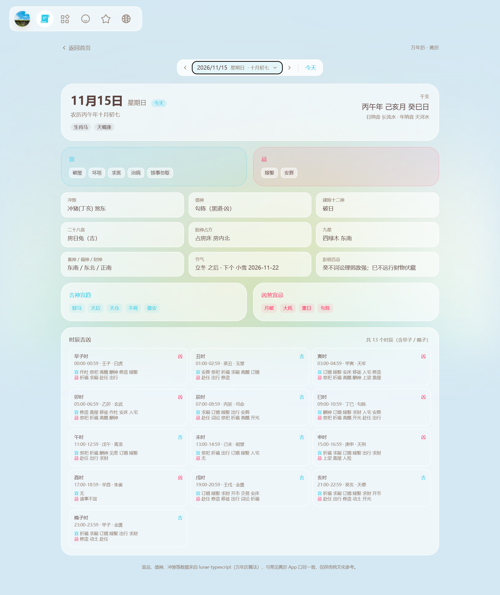

### 12.7 边界

- 支持范围约 **1900–2100**；超出的日期会显示「查不到黄历数据」，不会崩；
- 宜忌是传统通书算法推出来的，不同万年历 App 口径略有差异，页面底部已注明「仅供传统文化参考」；
- `/huangli` 是静态壳 + 客户端渲染（`useSearchParams` 包在 `Suspense` 里），首屏会有一瞬间的「黄历加载中…」；
- 黄历页目前只能从日历卡片进入，没有加进导航栏；要加入口可以在 `src/components/nav-card.tsx` 的 `list` 里加一项。

### 12.8 日期选择 UI 重做（样式统一）

第一版用的是浏览器原生 `<input type="date">`，控件外观跟站点的圆角卡片风格完全不搭（灰色方框 + 系统日历图标），
所以整条工具栏重做了一遍，全部换成站点自己的视觉语言。

#### 工具条

一个圆角胶囊里放五件事，替代原来的「按钮 + 原生输入框 + 按钮 + 今天」四个散装元素：

```text
‹   2026/11/15 星期日 · 十月初七 ⌄   ›   |   今天
```

- `‹` / `›`：前一天 / 后一天（图标按钮，hover 出品牌色）
- 中间：日期 + 星期 + 农历，点开日历浮层
- `| 今天`：分隔线 + 品牌色文字按钮
- 移动端自动隐藏农历那一段，避免挤压

#### 日历浮层（自绘，不是浏览器控件）

- 头部 `« ‹ 2026年11月 › »`：可翻月、翻年；到了 1900 / 2100 边界自动停住
- 7 列日期格：数字 + 农历日（和首页日历卡片同一套写法）
- 选中日期用**和首页「今天」相同的品牌渐变**，今天但未选中时用品牌色描边
- 底部：支持年份提示 + 「回到今天」
- 交互：点外部关闭、Esc 关闭、点日期即跳转并关闭；`key={dateStr}` 保证每次打开都定位到当前日期所在月

#### 顺带统一的细节

| 位置 | 之前 | 现在 |
| --- | --- | --- |
| 返回首页 | 纯文字 ← | 图标 + 文字，hover 变品牌色 |
| 浮层背景 | 半透明白（下面内容会透出来） | 纯白 + 阴影，日历可读性优先 |
| 移动端「干支」块 | 右对齐，挤在卡片中间 | 左对齐，和左侧信息同一列 |
| 选中日样式 | 纯色品牌底 | 与首页日历「今天」一致的渐变 |

#### 验证

| 用例 | 结果 |
| --- | --- |
| 点日期按钮 | 浮层展开，默认显示当前日期所在月 |
| 「上个月」「下一年」 | 2026年11月 → 2026年10月 → 2027年10月 |
| 点 2027-10-08 | 跳转 `?date=2027-10-08`，页面显示「10月8日 / 农历丁未年九月初九」，浮层自动关闭 |
| Esc / 点空白处 | 都能关闭 |
| 工具条「今天」 | 回到今天 |
| 390×844 移动端 | 工具条与浮层都完整显示，浮层 `max-w-[calc(100vw-2rem)]` 不会溢出 |
| 控制台 / 类型 / 构建 | 0 报错；`tsc --noEmit` 0 error；`pnpm build` 通过 |

> 原来的 `<input type="date">` 已移除（它没法用 CSS 改造成站点风格）。
> 如果以后想用系统原生日历（比如手机上的原生 picker），可以在浮层里再放一个原生输入框作为兜底。


---

## 13. 功能调整：时钟页只保留当前时间（精确到秒）

**需求**：删掉秒表和计时器，`/clock` 只显示主页面那个时间，并且精确到秒。

### 13.1 `/clock` 现在的内容

只剩一个七段数码管的时钟：**时 : 分 : 秒**，每秒刷新。

| 改动 | 说明 |
| --- | --- |
| 删除秒表 | 模式切换（秒表 / 计时器）、计次按钮、圈数列表、`performance.now()` 计时循环 |
| 删除计时器 | 时/分/秒输入框、开始/暂停、重置、倒计时逻辑 |
| 保留并改造显示 | 原来的 `TimeDisplay`（显示"已用时间"）换成显示"当前时间"的 6 位数字 |
| 秒级刷新 | `setTimeout` 对齐到**下一个整秒**（`1000 - Date.now() % 1000`），不是 `setInterval(1000)`，所以不会随运行时间累积偏差 |
| 冒号闪烁 | 奇数秒时冒号变淡，像真实电子钟 |
| 自适应尺寸 | 数字宽度 `8.5vw`（34–78px）、高度按 29:52 原比例，390 宽手机也不会横向溢出 |

> 旧实现完整地留在参考仓库的 `src/app/clock/page.tsx` 里（本项目当时是原样复制过来的），
> 需要恢复秒表/计时器时直接从那里取回即可；`doc/` 里也有本节记录了删除范围。

### 13.2 顺带：首页时钟卡片也显示秒

需求里"让时间精确到秒"同样适用于首页那块时钟，所以：

- `src/config/site-content.json`：`clockShowSeconds` 由 `false` 改成 `true`
- `src/config/card-styles.json`：`clockCard.width` 由 **232 加宽到 304**，6 位数字才装得下
- `src/app/(home)/clock-card.tsx`：数字保持原来的 **29×52** 尺寸不再缩小；冒号两侧加了 `mx-1.5` 间距，
  数字和冒号不再挤在一起（实测数字左右各留 17px，`scrollWidth === clientWidth`，不溢出）
- `src/app/clock/page.tsx`：冒号同样加了 `mx-1 sm:mx-2`，两个界面的节奏保持一致

这个开关仍然可以在「网站设置 → 时钟显示秒数」里关掉；关掉后是四位数字，卡片会显得宽松一些，
宽度也可以在「首页布局」里直接改。

### 13.3 过程中踩到的一个坑

`/clock` 是构建时预渲染的静态页。第一版用 `useState(() => new Date())` 直接渲染，
服务端那一刻的秒数和浏览器打开时的秒数必然不同，控制台报：

```
A tree hydrated but some attributes of the server rendered HTML didn't match the client properties.
```

因为七段数字是 SVG，`fill` 属性不一样就触发警告。修法：**挂载后再渲染真实时间**，
首帧用同尺寸的占位块（`animate-pulse`），既不报 hydration 警告，也不产生布局跳动。

### 13.4 验证

| 用例 | 结果 |
| --- | --- |
| 页面文案 | 不含「秒表」「计时器」「计次」，只剩时钟 |
| 每秒更新 | 连续 3 秒截屏哈希全部不同（`0775115c7e → 5fc18f62eb → d411559985`） |
| 首页时钟卡片 | 宽 304，6 位数字各 29×52，左右各留 17px，无溢出 |
| 390×844 移动端 | 面板宽 294px < 390px，无横向滚动 |
| 控制台 | 0 个页面异常 / 0 个 JS 报错（hydration 警告已消除） |
| 类型 / 构建 | `tsc --noEmit` 0 error；`pnpm build` 通过（`/clock` 静态预渲染 ○） |

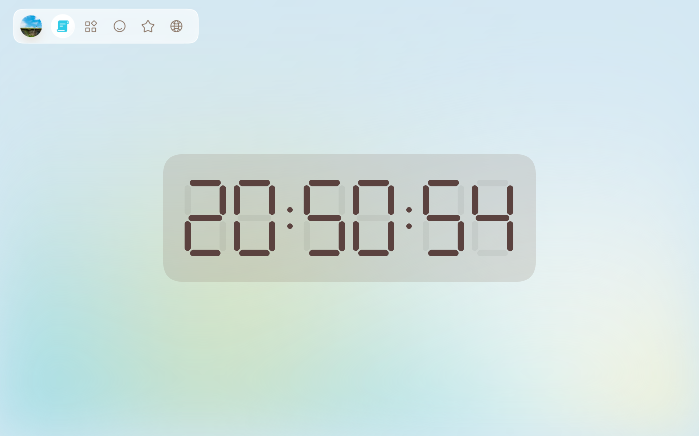


---

## 14. 主页去掉「改配置」，私钥导入挪到写作流程，并恢复真实写作器

**需求**：主页不需要改配置这个功能，删掉；导入密钥放到点击「写文章」时强制导入；写作功能参考参考仓库实现。

### 14.1 删掉了什么（主页配置）

| 删除项 | 位置 | 说明 |
| --- | --- | --- |
| 配置弹窗组件 | `src/app/(home)/config-dialog/`（11 个文件） | 整块删除：站点设置、色彩配置、首页布局、图片/社交按钮/备案/帽子等 tab |
| 保存配置的服务 | `src/app/(home)/services/push-site-content.ts` | 只被配置弹窗引用，随弹窗一起删除；`(home)/services` 目录随之变空，一并删除 |
| 快捷键 | `src/app/(home)/page.tsx` | `Ctrl+L` / `Ctrl+,` 打开弹窗的 `useEffect` 整段注释保留，不再挂载 |
| 弹窗渲染 | `src/app/(home)/page.tsx` | `<ConfigDialog />` 注释保留 |
| ⋯ 按钮 | `src/app/(home)/write-buttons.tsx` | 「写文章」旁边那个只用来开配置的圆点按钮 |

**副作用（要知道）**：

- 卡片宽高、主题色、站点标题、社交按钮等**不再能在网页里改**，直接改 `src/config/card-styles.json`、`src/config/site-content.json` 即可；
- 「进入主页拖拽布局」的入口原本在配置弹窗的「首页布局」标签里，所以拖拽布局也一起失效了。
  首页那段「正在编辑首页布局 / 保存偏移」的工具条代码保留着（`editing` 永远不会变成 true），需要恢复时把配置弹窗放回来即可；
- 站点内容提交到 GitHub 的能力（`push-site-content`）也一起没了，需要时从参考仓库取回。

> 第 3 节里的 `screenshots/config-layout.png` 是**删除前**的配置弹窗截图，仅作历史记录。

### 14.2 私钥导入挪到「写文章」

两条入口，都强制：

1. **首页「写文章」按钮**（`write-buttons.tsx`）：没导入过私钥 → 直接弹出 `.pem` 文件选择框 →
   校验内容里是否有 `BEGIN ... PRIVATE KEY` → `setPrivateKey()` → 成功后 `router.push('/write')`；
   选错文件会提示「这不是有效的 .pem 私钥文件」，取消则停在首页。
2. **直接访问 `/write` 或 `/write/[slug]`**：新增布局级守卫 `src/app/write/layout.tsx`，
   未授权时只渲染 `WriteAuthGate`（🔑 说明卡 + 「选择 .pem 私钥文件」+ 回首页），编辑器根本不会挂载。

私钥只保存在浏览器内存里；`site-content.json` 的 `isCachePem` 是 `false`，所以**刷新页面需要重新导入**。
如果想让它记住（加密存 sessionStorage），把 `isCachePem` 改成 `true`——配置弹窗已删除，只能改 JSON 文件。

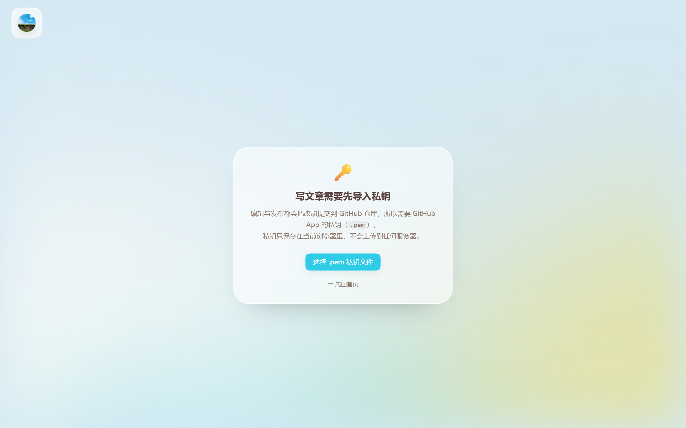

### 14.3 写作器（从参考仓库恢复）

新增依赖（与参考仓库同版本线）：

```text
@tiptap/core @tiptap/react @tiptap/starter-kit @tiptap/extension-image
@tiptap/extension-link @tiptap/extensions @tiptap/markdown @tiptap/pm   → 3.34.0
```

文件（21 个）：

| 目录 | 文件 |
| --- | --- |
| `src/app/write/` | `page.tsx`（覆盖原占位页）、`[slug]/page.tsx`（覆盖原占位页）、`layout.tsx`（**新增**：私钥守卫） |
| `components/` | `editor.tsx`（Tiptap 编辑器）、`preview.tsx`、`sidebar.tsx`、`actions.tsx`、`auth-gate.tsx`（**新增**） |
| `components/sections/` | `meta-section.tsx`、`cover-section.tsx`、`images-section.tsx`、`attachments-section.tsx` |
| `components/ui/` | `tag-input.tsx` |
| `extensions/` | `resolved-image.tsx`（正文图片的 NodeView） |
| `hooks/` | `use-load-blog.ts`、`use-publish.ts`、`use-write-data.ts` |
| `stores/` | `write-store.ts`、`preview-store.ts` |
| `services/` | `push-blog.ts`、`delete-blog.ts` |
| `lib/` | `md-title.ts`、`types.ts` |

能做的事（与参考仓库一致）：

- 所见即所得编辑（Tiptap + Markdown 扩展），标题取正文第一个 `# H1`；
- 侧栏：封面（本地上传 / URL）、Slug、摘要、标签、分类、发布时间、隐藏文章、附件；
- 图片按 SHA-256 去重后随文章一起提交；
- 「导入 MD」把本地 Markdown 读进编辑器；
- 「预览」用站内文章样式渲染；
- 「发布 / 更新 / 删除」走 GitHub App：`blob → tree → commit → ref`（`lib/github-commit.ts`）。

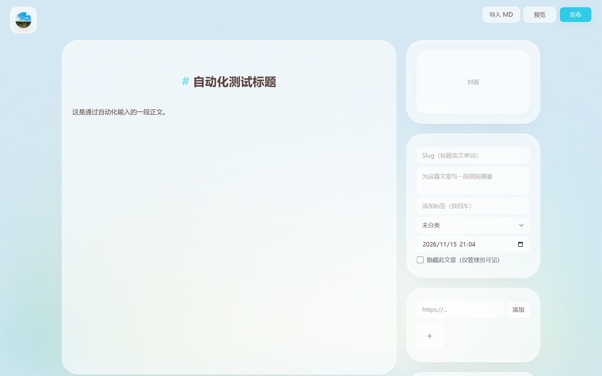

### 14.4 验证（无头 Chrome 实测）

| 用例 | 结果 |
| --- | --- |
| 未授权打开 `/write` | 只出现「写文章需要先导入私钥」，编辑器不渲染 |
| 未授权打开 `/write/hello-world` | 同上，守卫生效 |
| 首页点「写文章」 | 弹出文件选择框；选入 `.pem` 后跳到 `/write` 并出现编辑器、侧栏与「发布」按钮 |
| 编辑器输入 | 输入 `# 自动化测试标题` + 正文，页面正确显示 H1 与段落 |
| 点「预览」 | 预览页出现同一标题与正文 |
| 首页 `Ctrl+L` | 不再出现配置弹窗，页面也没有任何配置入口 |
| 控制台 | 0 个页面异常 / 0 个 JS 报错 |
| 类型 / 构建 | `tsc --noEmit` 0 error；`pnpm build` 通过（`/write` 静态 ○、`/write/[slug]` 动态 ƒ） |

> 说明：验证用的是**假的 .pem**，只覆盖到"能进编辑器、能预览"。
> 真正点「发布」需要你在 `src/consts.ts` 的 `GITHUB_CONFIG` 配好自己的仓库，再用 GitHub App 生成的真实私钥；
> 假私钥点发布会报错（预期行为）。

---

## 15. 写作器：默认 Markdown 源码模式 + Typora 式段落工具条 + 修复「隐藏此文章」

### 15.1 默认打开就是 Markdown 源码模式

`write-store` 新增 `sourceMode`（默认 `true`），编辑器里同时挂着一个受控 `<textarea>` 和 Tiptap 实例：

| 项 | 行为 |
| --- | --- |
| 默认模式 | **源代码模式**：直接看到并编辑 Markdown 原文，等宽字体，带字符统计 |
| 切换按钮 | 右上角「源代码模式 / 退出源代码模式」（在「导入 MD」左边） |
| 快捷键 | `Ctrl+/`（macOS `⌘+/`），与 Typora 一致 |
| 状态栏 | 左下角显示当前模式，右下角显示 `字符数 · Ctrl+/ 切换模式` |
| 双向同步 | 源码里改 → Tiptap 静默 `setContent`；所见即所得里改 → `getMarkdown()` 回写 `form.md`；标题始终取第一个 `# H1` |
| 切回所见即所得 | 自动把光标放到正文末尾；源码模式自动聚焦文本框 |
| 新建文章 | `reset()` 时回到源码模式 |

两种模式共用同一份 `form.md`，所以预览、发布、导入 MD、源码编辑永远是一致的。

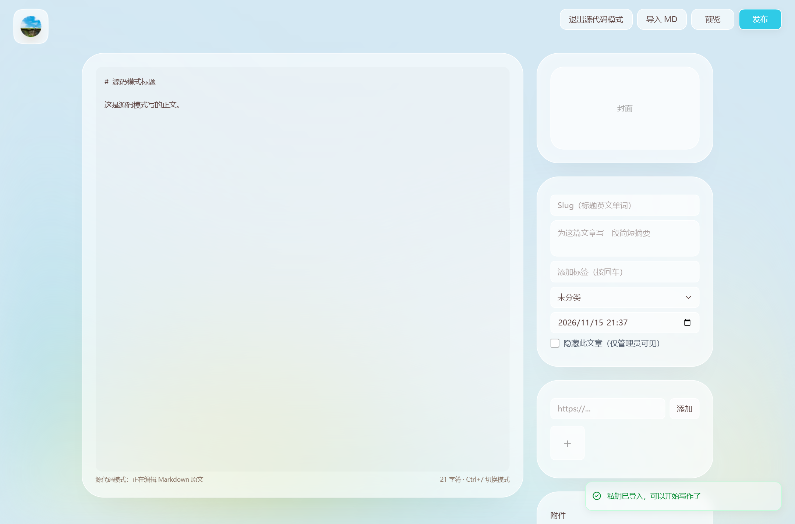

### 15.2 Typora 风格的段落 / 格式工具条

参考 Typora 的「段落」菜单，在编辑器顶部加了一排按钮（只在所见即所得模式下显示）：

| 分组 | 按钮 | 等价 Markdown |
| --- | --- | --- |
| 段落 | 正文 | 普通段落 |
| 段落 | H1 / H2 / H3 | `#` / `##` / `###` |
| 块级 | 引用 | `> ` |
| 块级 | 无序列表 | `- ` |
| 块级 | 有序列表 | `1. ` |
| 块级 | 代码块 | ```` ``` ```` |
| 块级 | 分隔线 | `---` |
| 行内 | 加粗 / 斜体 / 删除线 / 行内代码 | `**x**` / `*x*` / `~~x~~` / `` `x` `` |
| 行内 | 链接（`Ctrl+K`） | `[x](url)` |
| 其它 | 清除格式 | 去掉行内标记 + 还原成普通段落 |

- 按钮有 active 高亮（光标在标题/引用/列表里时对应按钮会亮）；
- 订阅了 Tiptap 的 `transaction` 事件，选中变化时高亮会跟着变；
- 键盘快捷键沿用 Tiptap 默认：`Ctrl+B/I`、`Ctrl+Shift+S`、`Ctrl+E`、`Ctrl+K`。

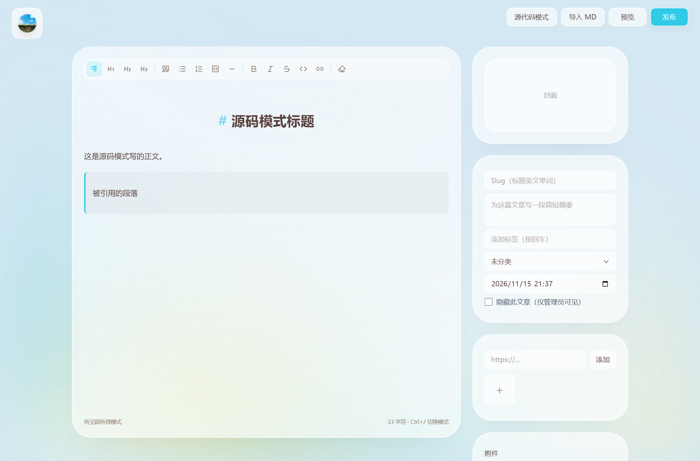

### 15.3 修复「隐藏此文章」不生效

**根因有两个**（都在读取侧，写入侧本来是好的）：

1. `push-blog.ts` 其实已经正确把 `hidden` 写进了 `public/blogs/<slug>/config.json` 和 `index.json`；
   但**文章详情页 `/blog/[id]` 从来没检查过 `config.hidden`** —— 只要知道链接，访客照样能读全文，
   列表里虽然过滤了，隐藏形同虚设。
2. 管理员自己在列表里看不到任何"隐藏"标记，选中隐藏后界面毫无变化，很容易以为功能坏了
   （实际上按设计隐藏文章对管理员仍然可见）。

**修复**：

| 文件 | 改动 |
| --- | --- |
| `src/app/blog/[id]/page.tsx` | 新增 `useAuthStore`；`config.hidden && !isAuth` 时只渲染「🔒 这篇文章被作者设为隐藏，仅管理员可见」，不渲染正文 |
| `src/app/blog/page.tsx` | 列表标题后面给 `hidden` 的文章加一个「隐藏」小标签（仅管理员能看到这些条目，所以只有管理员会看到标签） |

写入侧复检：编辑器里的复选框 → `updateForm({ hidden })` → `push-blog` 的 `config` 与 `prepareBlogsIndex` 都带 `hidden`，这条链路本身没动。

### 15.4 验证（无头 Chrome）

| 用例 | 结果 |
| --- | --- |
| 打开 `/write` | 默认源码模式（textarea 可见、工具条隐藏），按钮文案「退出源代码模式」 |
| 源码里输入 `# 标题` + 正文 | 切到所见即所得后正确渲染；切回源码 Markdown 一致 |
| 依次点 H2 / 引用 / 无序列表 / 代码块 | Markdown 分别变成 `## 二级标题行`、`> 引用段落`、`- 列表项`、```` ``` ```` |
| `Ctrl+B` 后输入文字 | Markdown 出现 `**这段是加粗的**` |
| `Ctrl+/` 两次 | 模式来回切换正常 |
| 隐藏文章（同时改 `config.json` + `index.json`）→ 访客列表 | 不出现 |
| 访客直接访问 `/blog/hello-world` | 显示「仅管理员可见」，**正文不泄露** |
| 管理员（站内跳转，保持登录态） | 列表里能看到该文章 + 「隐藏」标签，点进去可正常阅读 |
| 控制台 / 类型 / 构建 | 0 报错；`tsc --noEmit` 0 error；`pnpm build` 通过 |

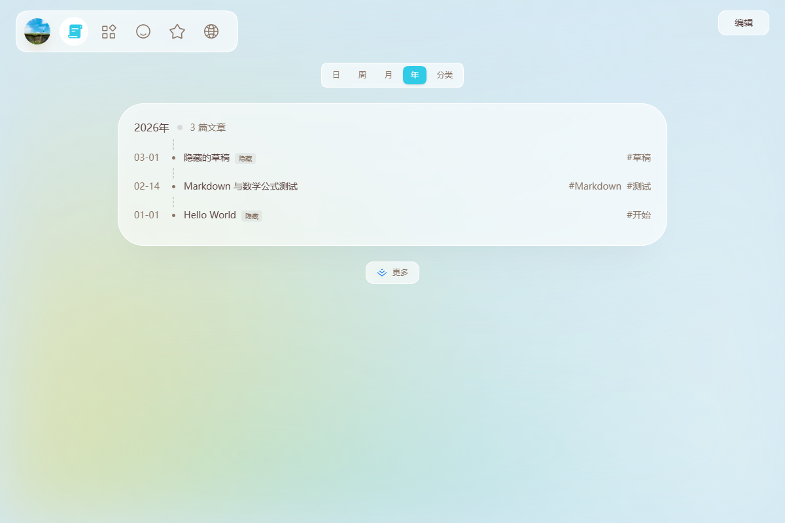

> 注意：`hidden` 的可见性判断依赖浏览器里的登录态（私钥）。
> 由于默认不缓存私钥，**刷新后管理员自己也会看到"仅管理员可见"**，重新导入私钥即可——这是有意的安全默认值。

---

## 16. 写作器补齐 Typora 的表格 / 任务列表 / 公式块 / 目录

上次留的四个"高级段落"功能这次全部补上，编辑器侧解析、序列化、预览、发布全链路都通了。

### 16.1 新增依赖

| 包 | 用途 |
| --- | --- |
| `@tiptap/extension-table`（含 row/header/cell） | 表格节点，自带 GFM 表格的 Markdown 解析 / 序列化 |
| `@tiptap/extension-task-list` + `task-item` | 任务列表 `- [ ]` / `- [x]` |
| `katex`（项目里本来就有） | 公式块在编辑器内实时渲染 |

> 公式块没有现成扩展：自己写了 `src/app/write/extensions/math-block.tsx`（Tiptap Node + KaTeX NodeView + Markdown 序列化钩子）。

### 16.2 四个功能怎么用

| 功能 | 工具条按钮 | 编辑器里的样子 | Markdown |
| --- | --- | --- | --- |
| 表格 | 表格图标（插入 3×3 带表头） | 有边框、表头浅色底、可拖列宽；光标在表格里时工具条多出「+ 行 / − 行 / + 列 / − 列 / 切换表头 / 删除表格」 | GFM 管道表格 |
| 任务列表 | ✓☐ 图标 | 带可点复选框的列表，勾选状态即时保存 | `- [ ] 待办` / `- [x] 已完成` |
| 公式块 | Σ 图标（弹窗输入 LaTeX） | KaTeX 实时渲染的居中块，**点击可再次编辑** | `$$ … $$` |
| 目录 | 列表树图标 | 按当前 H1–H4 生成嵌套锚点列表（Typora 的 `[TOC]` 等价物） | `- [标题](#锚点)` |

实现要点：

- **公式块的解析**：`Markdown.configure({ marked })` 传入一个自定义 `Marked` 实例，注册 `$$…$$` 的 block tokenizer；
  节点通过 `parseMarkdown` / `renderMarkdown` 两个钩子和它对接，所以**已有文章里的公式块能直接读进编辑器**，改完再原样写回。
- **目录锚点**：和 `lib/markdown-renderer.ts` 里的 `slugify` 规则保持一致（中文保留、空格转 `-`），
  这样预览和线上文章页的 `id` 能对上，点目录能跳。
- **表格**：`TableKit.configure({ table: { resizable: true } })`，另写了编辑器内的表格 / 任务列表样式（`globals.css` 的 `.tiptap-editor` 段）。

### 16.3 验证（无头 Chrome）

| 用例 | 结果 |
| --- | --- |
| 源码模式粘贴含表格/任务/公式/目录的 Markdown → 切所见即所得 | 表格 1 个、任务项 3 个、KaTeX 1 个、H2 4 个，全部正确解析 |
| 点「表格」 | 插入 3×3 表格，表格操作行出现，单元格可输入 |
| 点「任务列表」 | 生成 `- [ ]` 列表，勾选可切换 |
| 点「公式块」（输入 `\int_0^1 x^2 dx = 1/3`） | 编辑器内 KaTeX 正确渲染，Markdown 为 `$$ … $$` |
| 点「目录」 | 生成嵌套列表 `- [一级标题](#一级标题)`，层级按 H2/H3 缩进 |
| 切回源码模式 | 表格是 GFM 管道表格、任务列表是 `- [ ]`、公式是 `$$`、目录是锚点链接 |
| 再切回所见即所得（往返） | 公式节点 1、表格 1、任务列表 1，结构不丢 |
| 点「预览」 | 表格渲染成表格、任务项带复选框、公式是 KaTeX、目录锚点 6 个链接 |
| 打开已有文章 `/write/markdown-demo` | 正文里的 `$$` 变成公式节点（1 个），代码块 2 个保留，源码模式里 `$$` 与 ` ``` ` 原样保留 |
| 控制台 / 类型 / 构建 | 0 报错；`tsc --noEmit` 0 error；`pnpm build` 通过 |

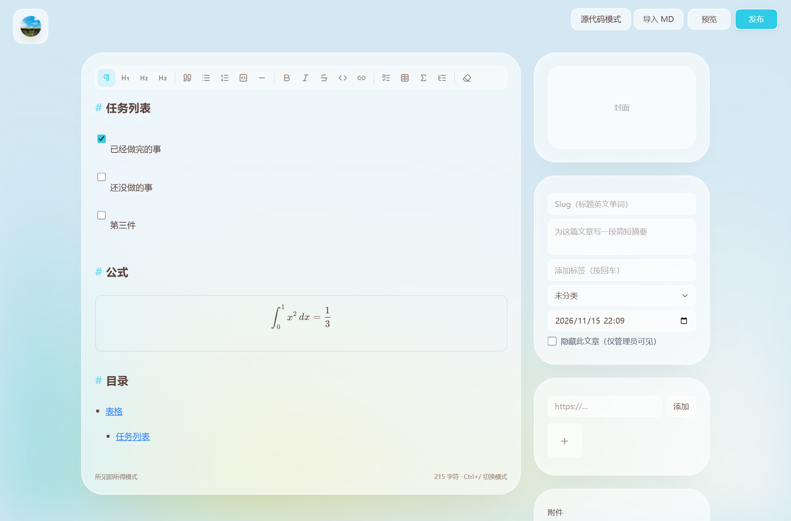

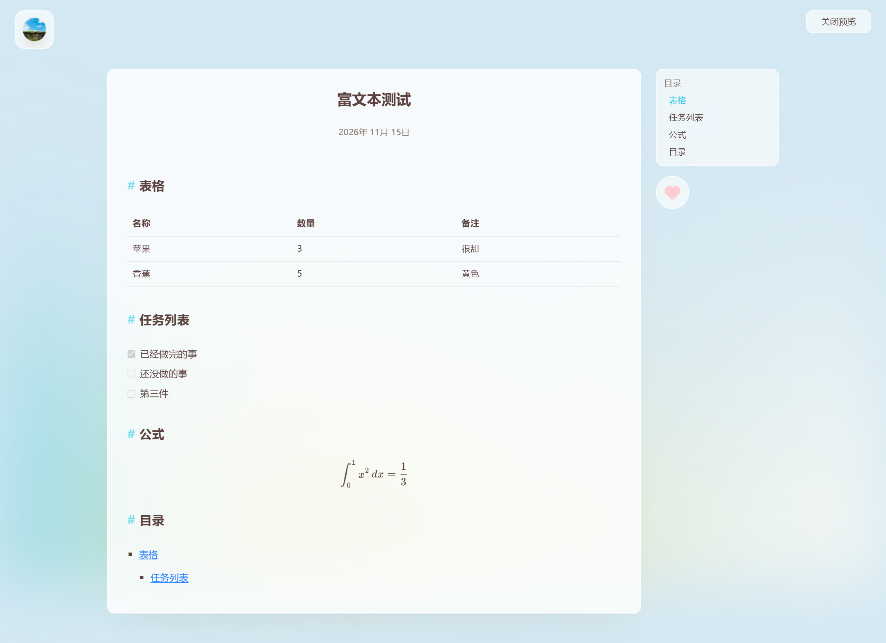

### 16.4 已知边界

- 公式只做了**块级** `$$…$$`；行内 `$x$` 在编辑器里按普通文本显示（发布出去仍会被渲染成公式），
  需要所见即所得的行内公式可以再做一个 inline mark；
- 表格单元格里不支持嵌套列表（GFM 表格本身没有这个表达能力，序列化会拍平成文本）；
- 目录是按点击那一刻的标题生成的**静态列表**，之后改了标题需要重新点一次「目录」。
